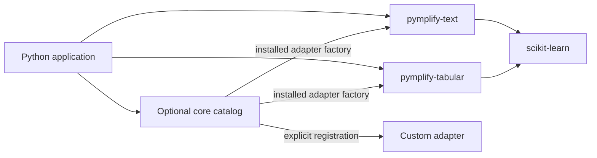

# Architecture

Pymplify is a monorepo of independent distributions. Shared development does not
require shared releases: each `packages/*` directory contains its own
`pyproject.toml`, README, license, `src/`, and tests.

`pymplify-core` provides contracts, catalogs, entry point discovery, shared errors,
and dependency loading. It has no ML framework dependencies, static imports of
adapter packages, or global mutable registry. Each application chooses when to
discover installed plugins or register its own operations. Catalogs are independent.

`pymplify-text` wraps TF-IDF vectorization. `pymplify-tabular` wraps numerical
feature standardization. Both use scikit-learn, declare their operations through
lightweight factories, and preserve the fitted model and native transformed data.
They depend on core but not on one another. Direct imports work without discovery.

## Adapter boundary

An `Operation` is a named callable with a description. An `Adapter` groups at
least one operation under an identifier and declares its upstream library and
optional aliases. The contract is validated before registration. Installing an
adapter advertises its factory in the `pymplify.adapters` entry point group.

Discovery imports each advertised factory and obtains its descriptor; it does not
inspect arbitrary modules or run operations. Factories must defer backend imports
and processing. Broken plugins are either reported in `catalog.discovery_issues`
or raised immediately in strict mode. Unknown library queries return no matches.
Dispatch requires an explicit adapter and operation, avoiding ambiguity when
multiple adapters support one library.

Core does not install packages, search GitHub, or generate integrations. The
catalog connects already implemented workflows. Automatic source analysis and
simplification suggestions remain future work.

## Dependencies and configuration

Required dependencies are declared in package metadata and installed by pip.
Optional heavy backends in future packages should use separate extras. Backends
are loaded when an operation is called; importing public modules remains
lightweight. Checking availability does not install dependencies automatically.

Adapters use explicit function arguments, without a custom configuration file
format. A universal configuration system should be introduced only when there is
a shared practical need. Upstream parameters retain their names.

## Extending the ecosystem

1. Create a scaffold: `python tools/new_package.py <area>`.
2. Choose a specific user task and review the upstream license.
3. Implement a useful API preserving access to original objects and native data.
4. Implement the adapter factory and enable its entry point only when it works.
5. Add dependencies, real-backend tests, a runnable example, and catalog checks.
6. Add `src/` to pytest and include the package in CI installation, builds, and smoke checks.
7. Document the API, limitations, and versions, and add the package to the README table.

Applications can instead register local callables with `Catalog.register` without
packaging a plugin. See [the catalog API](catalog-api.md) for both paths.
