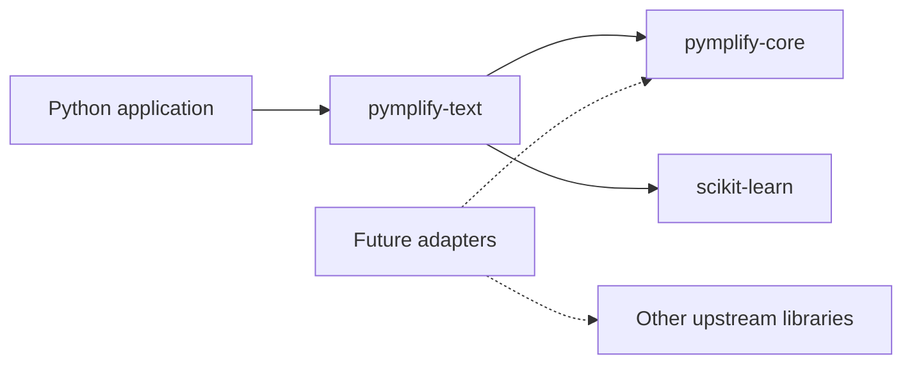

# Architecture

Pymplify is organized as a monorepo of independent distributions.
Shared development does not require shared releases: each `packages/*` directory
contains its own `pyproject.toml`, README, license, `src/`, and tests.

`pymplify-core` only provides shared errors and dependency loading.
It does not import PyTorch, TensorFlow, or scikit-learn, register plugins, or hold
global mutable state. A new adapter may depend on core, but core does not depend
on adapters. Direct dependencies between adapters require justification.

`pymplify-text` establishes the first practical conventions: a useful call with
default settings, explicit advanced parameters, and the original backend object
in the result. The package does not reimplement TF-IDF or copy upstream code.

## Dependencies and configuration

Required dependencies are declared in package metadata and installed by pip.
Optional heavy backends in future packages should use separate extras.
Backends are loaded when an operation is called; importing the public module
should remain lightweight. Checking availability does not install dependencies
automatically.

The current adapter is configured through function arguments, without a custom
file format. A universal configuration system should be introduced only when
there is a shared practical need. Upstream parameters should not be renamed
without a reason.

## Extending the ecosystem

1. Create a scaffold: `python tools/new_package.py <area>`.
2. Choose a specific user task and review the upstream license.
3. Implement a minimal useful API that preserves access to the original objects.
4. Add dependencies, tests against the real backend, and a runnable example.
5. Add the `src/` path to pytest and the package to CI installation, builds, and smoke checks.
6. Document the API, limitations, and versions, and add the package to the README table.

A unified interface and automatic package discovery are not implemented yet.
If introduced, they must preserve independent installation and use of adapters.
Loading a module through `require_dependency` only imports it; it does not discover
its workflows or generate an integration.
